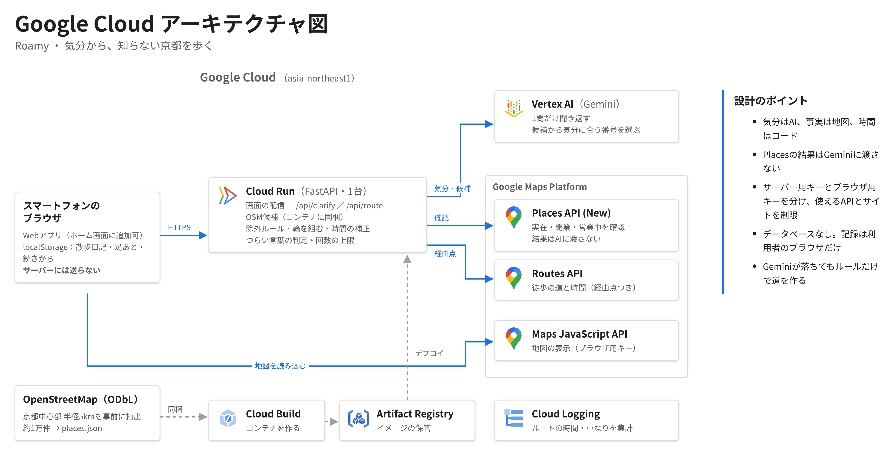
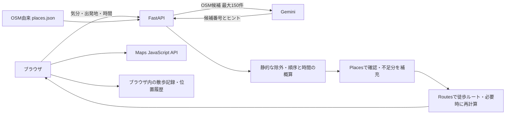

# Roamy（ローミー）— 気分から、知らない京都を歩く

> 知らない場所は、目的地にできない。だから、気分を目的地にする。

気分をひとこと入力すると、AIが1問だけ聞き返し、その気分を感じられる「いま開いている実在の場所」をつないで、指定した時間で一周できる散歩ルートをつくるWebアプリです。
DevFest GDG Japan Hackathon 2026（テーマ：Own the why）向けの作品です。

- **デモ**：https://walk-780700843334.asia-northeast1.run.app （2026-11-14まで公開）
- **発表動画**：[動画のURL]
- **チーム**：[チーム名] ／ [メンバー名]（画面）・[メンバー名]（サーバー・クラウド）

## なぜつくったか

地図アプリは、行き先が決まっている人の道具です。「カフェ」「神社」と打てば答えてくれますが、名前を知らない場所は目的地にできず、「泣きたい」「にぎやかに過ごしたい」という気分からは探せません。
引っ越してきた人も、旅で来た人も、その街の初心者です。Roamyは名所ではなく気分で場所を選びます。静けさを求めれば静かな場所へ、にぎやかさを求めればにぎやかな場所へ案内します。

## 仕組み（気分はAIに、事実は地図に、時間はコードに）



- OpenStreetMap由来の候補（京都中心部 約1万件）から、Gemini（Vertex AI）が気分に合う候補を**番号で**選ぶ。
- 実在・閉業・営業中かは Places API で確認する。**Placesの結果はAIに渡さない。**
- 除外ルール、順番、時間合わせはコードで決め、Routes API で徒歩の道と時間を出す。行きと帰りの道が重なれば回り道を足す。
- Cloud Run 1台。データベースは持たず、記録は利用者のブラウザにだけ残す。

## 設計判断の記録（ADR）

- [ADR 0001](docs/adr/0001-place-selection.md)：場所の選び方。5つの方式を同じ条件で比べ、OSM → Gemini → Places で確認する方式を採用した。
- [ADR 0002](docs/adr/0002-walk-records-in-browser.md)：サーバーDBを使わず、ブラウザに記録を置く。

---

以下は開発者向けの情報です。対象エリアは京都市中心部（北緯35.003・東経135.765から半径約5km）を前提にしています。場所データは別途生成が必要です。

## このリポジトリの読み方

- **このREADME**：全体像、起動、サーバー設定、API、デプロイの入口。
- [web/README.md](web/README.md)：画面開発、キー不要の見本、Googleマップ接続、画面側の確認手順。
- [web/TRACKING.md](web/TRACKING.md)：位置履歴の品質・保存上限、地図表示、プライバシーの詳細。
- [web/RESTART.md](web/RESTART.md)：途中終了、新しい散歩、再読込後の再開。
- [ADR 0002](docs/adr/0002-walk-records-in-browser.md)：サーバーDBを使わず、ブラウザに記録を置く判断。

`app.py`（Streamlit）と `poc.py` は別のローカルPoCです。`picker.py`、`experiment.py`、`method_c.py`、`eval_picker.py` は選定・比較実験用です。現在のWebアプリの起動には使わず、実験の設定・制限を本番APIの仕様と混同しないでください。

## まず見本を動かす（APIキー・場所データ不要）

以下のコマンドはリポジトリ直下で実行します。Python 3が必要です。

```bash
python3 -m http.server 8503 --bind 127.0.0.1 --directory web
```

[http://localhost:8503/?mock=1](http://localhost:8503/?mock=1) を開きます。終了はControl+C。
見本は固定JSONを読み、Gemini・Places・Routes・自分たちのAPIを呼びません。
`web/config.js` にブラウザ用MapsキーがあるとGoogleマップは読み込みます。キー未設定なら模式図になります。
操作・GPSの試し方は [web/README.md](web/README.md) を参照してください。

## 通常モードをローカルで動かす

必要なもの：Python 3.12以上（`.python-version` は3.12）、uv、Google CloudのプロジェクトとVertex AIの認証、サーバー用Places/Routesキー、ブラウザ用Maps JavaScriptキー。

### 1. 依存関係と設定

```bash
uv sync --locked
cp .env.example .env
cp web/config.example.js web/config.js
```

`.env` を自分のプロジェクトに合わせて編集し、ローカルのVertex AI認証には `gcloud auth application-default login` を実行します。
`.env.example` は現在のWebアプリ用のひな形です。`web/config.js` には **ブラウザ用キーだけ** を設定します。
両ファイルはGit管理外です。ブラウザ用キーの制限は [web/README.md](web/README.md#googleマップと実apiに接続する) を参照してください。

主な環境変数（既定値は実装に基づく）：

- `GOOGLE_GENAI_USE_VERTEXAI=true`、`GOOGLE_CLOUD_PROJECT`、`GOOGLE_CLOUD_LOCATION=global`：Vertex AI接続用。
- `GEMINI_MODEL`：未設定時 `gemini-3.5-flash`。`api/llm.py` は出力検証失敗や429/503等で再試行し、`gemini-3.1-flash-lite` も試します。これらはコード内のモデル名で、利用可能性を保証するものではありません。
- `MAPS_API_KEY`：サーバー用。Places API (New)・Routes APIに制限します。未設定時、Routesは直線距離に基づく概算になりますが、Placesは既定で有効なので、キー不要の開発には `PLACES_CHECK=off` も必要です。
- `PLACES_CHECK`：既定 `on`。`off` は開発用で、営業未確認の店も注意付きで残します。
- `ROUTE_DAILY_LIMIT=30`、`ROUTE_PER_IP_HOUR=6`：ルート要求の全体日次／IP別時間上限。
- `OSM_FILE`、`OSM_RIVER_FILE`：生成元のOSM XML。下記を参照。
- `PLACES_JSON`：サーバーが読むJSONのパス。既定 `api/data/places.json`。

`LLM_PROVIDER=openai` は比較実験用の分岐です。通常運用は既定の `gemini` を使用します。

### 2. 場所データを生成

OSM XMLと生成済みJSONは同梱していません。京都の抽出データを `data/area.osm` に用意した場合：

```bash
uv run --env-file .env python scripts/build_osm_json.py
```

ひな形では `OSM_FILE=data/area.osm`、`OSM_RIVER_FILE=data/area.osm` を指定しています。
環境変数なしでスクリプトを実行すると、場所の入力は `data/area_poi.osm`、川の入力は `data/area.osm`（なければ場所の入力）です。
出力は `api/data/places.json`。川沿いの点も候補に加えます。データ更新後はサーバーを再起動してください（読込結果をキャッシュします）。

取得補助の `get_osm.sh` は `osmium`・`wget` とGNU系コマンドを前提にしたスクリプトです。
これらを用意したLinux環境では `bash get_osm.sh 35.0030 135.7650 5 kansai` で周辺を抽出できます。
地方データの初回取得は大きく、`.env` の `OSM_FILE` / `OSM_WALK_FILE` を書き換えます。macOSでは `apt-get` や `sed -i` がそのまま動かないため、別途抽出したXMLを指定してください。
現在のFastAPI版は `OSM_WALK_FILE` を使いません。

### 3. 起動

```bash
uv run --env-file .env uvicorn api.main:app --reload --port 8080
```

[http://localhost:8080](http://localhost:8080) を開きます。画面とAPIを同一サーバーで配信します。
`GET /api/health` の `places` で読込件数を確認できます。JSONがなければhealthとルート生成は失敗します。
画面だけの静的サーバーでは通常モードのAPIは動きません。

## 使い方と現在の動作

1. 気分を入力し、聞き返しの選択肢・自由記述・おまかせで方向を決める。
2. 歩く時間（画面は30 / 45 / 60分）と出発地を選び、ルートを作る。
3. 場所を「外す」とOSM IDを除外して再検索する。
4. 「歩いた道と記録をこのブラウザに保存する」（初期値オン）を確認し、歩きはじめる。
5. 近くに来た通知を目安に、本人が「着いた」を押す。自動では到着画面へ進まない。
6. ひとことメモを記録するか、その場所の記録を飛ばして次へ進む。5段階評価は現在の画面にはない。
7. 散歩日記・足あとマップで記録を見返す。途中終了や新しい散歩への切替もできる。

所要時間は **歩行のみ** の目安です。`api/route.py` の `STAY_MIN=0` で、立ち寄る時間は含みません。
再読込後は12時間以内の途中状態から、利用者の操作で再開できます。GPSは自動再開しません。
詳細は [web/RESTART.md](web/RESTART.md) を参照してください。

## 仕組みと制限



- Geminiには気分とOSM候補を渡し、候補番号を検証します。Placesの結果は渡しません。LLM失敗時は定型の聞き返し／ルールによる場所選びへ切り替え、応答に `fallback: true` を付けます。
- 私有地らしい名前、暗い時間の屋外・寺社・史跡、混雑回避時の有名所と周辺200mなどをコードで除外します。夜間判定は京都の月別概算です。
- Places確認は1ルート要求で最大8候補。川沿いは照会せず、キャッシュ命中時も外部通信しません。確認できない店などは除外しますが、日中の非店舗は警告付きで残ることがあり、全地点の実在・営業・立入可否を保証しません。
- APIの `include_ids` で明示指定した地点には通常の除外判定を適用しない分岐があります。現在の画面は空配列を送ります。
- Routesは重複する道を減らすため1計算につき最大2回、時間の補正で計算をもう1度行う場合があり、**1ルート要求につき最大4回** 呼びます。キーなしの概算線は実際の道路ではありません。
- `/api/route` は既定で全体30回/日・IP別6回/時、`/api/clarify` は全体200回/日・IP別20回/時。日次はJSTで切替。カウンターはプロセス内メモリで、再起動や複数プロセス・インスタンスをまたぐ厳密な上限ではありません。

## 保存とプライバシー

サーバーに散歩記録用DB・保存APIはありません。出発地はルート要求でサーバーに送り、経路計算にも使います。
歩行中の位置履歴・訪問メモは自分たちのサーバーへ送信しません。Googleマップ表示ではSDKによる通信が発生します。

ブラウザのlocalStorageには次を保存します。

- 同意、除外OSM ID（直近200件）、過去の道の表示設定。
- 保存を選んだ散歩日記（最大100回）：気分、訪問地点・座標、時刻、メモ、状態、経過秒数。
- 保存を選んだ位置履歴：1区間最大1,200点、全体最大20区間・6,000点、最大7日。アプリ起動・保存時に整理します。
- **途中再開用の一時状態 `yorimichi:active`**：出発地、気分、ルート、進行状況など。日記・位置履歴の保存チェックを外しても保存されます。12時間経過した状態は次の読込時に破棄し、終了・新規開始時にも消します。`maps_uri` は保存しませんが、polylineや地点情報を含みます。

チェックを外せば一切保存しない、という動作ではありません。保存を避けたい利用でこの一時状態が残る点は、現在の実装上の制約です。
日記から個別／一括削除でき、対応する位置履歴も消します。すべての設定・一時状態を消すにはブラウザのサイトデータを削除します。
保存先は端末・ブラウザ・オリジンごとに別で、恒久保存や端末間同期はありません。詳細は [web/TRACKING.md](web/TRACKING.md)。

## APIの入口

- `GET /api/health` → `{ok, places}`。
- `POST /api/clarify`：`{mood}` → `{question, options: [{label, crowd}], blocked}`。
- `POST /api/route`：`{mood, preference?, crowd?, lat, lon, minutes?, exclude_ids?, include_ids?}` → 解釈、地点、polyline、歩行／滞在／合計時間、区間、距離、帰属など。

入力の型と上限は [api/main.py](api/main.py) のPydanticモデルおよび、起動中の `/docs` が正本です。
`crowd` は `avoid` / `neutral` / `ok`。APIの時間指定は15〜120分（既定60分）で、画面の初期値45分とは別です。
コードに定義した危機的な語に一致するとLLM呼び出し前に止め、`blocked.message` を返します。
通常エラーは `{error}` とHTTPステータス（入力422、候補不足404、回数上限429、経路作成失敗502など）です。

## 確認

```bash
uv run --locked pytest -q
node --test web/tests/tracking.test.mjs web/tests/walk-restart.test.mjs
```

Python試験にはルール・経路計算と旧Streamlit PoCの試験が含まれます。JavaScript試験は位置履歴・途中終了などを最小DOMと仮の位置データで確認します。
これらは実API接続、ブラウザ描画、実機GPSの検証を代替しません。画面の手動確認は [web/README.md](web/README.md#確認手順) を参照してください。

## Cloud Runへのデプロイ

`Dockerfile` は `requirements.txt` でAPI用依存関係を入れ、`api/` と `web/` をコピーします。Streamlit PoCは配信しません。
先にローカルで `api/data/places.json` と `web/config.js` を用意し、Vertex AIを利用できる実行サービスアカウント・必要なAPI・キーを設定してください。

```bash
gcloud run deploy walk --source . --region asia-northeast1 \
  --allow-unauthenticated --max-instances 1 --memory 512Mi \
  --set-env-vars 'GOOGLE_GENAI_USE_VERTEXAI=true,GOOGLE_CLOUD_PROJECT=<project>,GOOGLE_CLOUD_LOCATION=global,GEMINI_MODEL=gemini-3.5-flash,ROUTE_DAILY_LIMIT=30,ROUTE_PER_IP_HOUR=6,MAPS_API_KEY=<server-key>'
```

プレースホルダーは実値に置き換えます。`.env` は自動で読み込まれず、アップロード対象外です。
`.gcloudignore` は `.gitignore` を取り込まないため、Git管理外の `api/data/places.json` と `web/config.js` も、ローカルに存在すればアップロード対象です。
`gcloud meta list-files-for-upload` で含まれることを確認してください。Gitのチェックアウトだけでは両ファイルは揃いません。
`--max-instances 1` はメモリ内回数制限を使うための設定ですが、費用の厳密な上限保証にはなりません。

デモURL：[Roamy（Cloud Run）](https://walk-780700843334.asia-northeast1.run.app)。2026-11-14まで公開し、その後サービスとキーを削除します。

## データと帰属

- 場所データ：© OpenStreetMap contributors（[ODbL](https://www.openstreetmap.org/copyright)）。
- 地図・場所確認・経路：Google Maps Platform（Maps JavaScript API / Places API / Routes API）。
- 技術判断：[docs/adr/](docs/adr/)。
- localStorageのキー名（`yorimichi:`）は旧名「よりみち」の名残です。保存済みの記録を引き継ぐため変えていません。