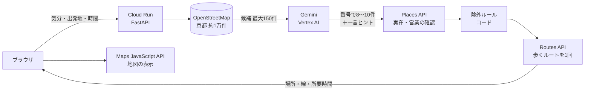

# よりみち — 気分から、知らない近所へ

> 知らないものは、検索できない。だから、歩いて出会う。

「泣きたい」「懐かしい雰囲気」のような気分をひとこと入れると、AI がどんな気分かを1問だけ聞き返し、
いま開いていて時間内に回れる **実在の場所** をつないだ散歩ルートをつくる Web アプリです。
着いたら画面は暗くなり、「次へ歩く」だけが残ります。

- 公開URL: https://walk-780700843334.asia-northeast1.run.app （2026-11-14 まで稼働）
- 対応エリア: 京都市中心部（四条烏丸から半径約5km）
- DevFest GDG Japan Hackathon 2026 提出作品

## なぜ作ったか

2025年に市区町村を越えて引っ越した人は約519万人（総務省「住民基本台帳人口移動報告 2025年結果」）。
転勤・単身赴任・進学・留学で知らない街に住み始めると、地図アプリは「カフェ」「神社」と打てば答えてくれるが、
**名前やジャンルを知らないものは検索できない**。気分から街に出会う入口をつくりたかった。

## 使い方

1. 気分をひとこと入力する
2. AI の聞き返し（3〜4択）から近いものを選ぶ。人の多さの好みもここで決まる
3. 散歩の時間（30 / 45 / 60分）と出発地を選ぶ
4. 地図と場所の一覧を見て、歩きはじめる
5. 着いたら「感じられた？」に答えて、ひとことメモを残す。記録は日付ごとに見返せる

## 仕組み



| 段階 | 使うもの | ポイント |
|---|---|---|
| 候補を出す | OpenStreetMap（事前に変換した `api/data/places.json`） | 種類ごとに上限を設けて偏りを防ぐ |
| 選ぶ | Gemini（Vertex AI、`gemini-3.5-flash`） | 候補の番号で選ばせる。一覧にない場所は作らせない。ヒントは30文字以内で事実を書かせない |
| 確かめる | Places API (New) Text Search | 閉業・営業時間外を除外。**Places の結果は AI に渡さない** |
| 除く | コードのルール | 私有地らしい名前、非公開の場所、日没後の屋外・寺社、混雑を避けたい人には有名所とその周囲200m |
| つなぐ | Routes API（徒歩） | 出発地 → 場所 → 出発地を1回の呼び出しで |
| 配信 | Cloud Run | 画面（`web/`）と API（`api/`）を1つのサービスで配信 |

技術を選んだ理由は [docs/adr/](docs/adr/) にまとめています。

- ADR 0001: 場所の選び方（5つの方式を比べて、OSM＋Gemini＋Places で確認を採用）〔作成中〕
- [ADR 0002: 歩いた記録はブラウザに保存し、DB は使わない](docs/adr/0002-walk-records-in-browser.md)

## 安全とプライバシー

- **つらい言葉**（「死にたい」など）は AI に送らず、コードで止めて相談窓口（厚生労働省「まもろうよ こころ」）を案内する
- **位置情報**：出発地はルート作成のときだけサーバーに送り、保存しない。歩いている間の現在地はブラウザの中だけで使う
- **歩いた記録とメモ**：ブラウザ（localStorage）にだけ保存し、サーバーには送らない
- **使いすぎの防止**：`/api/route` は全体で1日30回・1人1時間6回まで。Places の確認は1ルート最大8回

## API

| メソッド | パス | 送るもの | 返すもの |
|---|---|---|---|
| GET | `/api/health` | なし | `{ok, places}` |
| POST | `/api/clarify` | `{mood}` | `{question, options:[{label, crowd}], blocked}` |
| POST | `/api/route` | `{mood, preference, crowd, lat, lon, minutes, exclude_ids, include_ids}` | `{interpretation, places:[…], polyline, total_minutes, distance_m, sources, attributions, blocked}` |

- `crowd`: `avoid`（混雑を避けたい）/ `neutral` / `ok`
- つらい言葉のときは `blocked: {message}` を返し、それ以外の結果は返さない
- エラーは `{error}` とステータスコード（429 は回数の上限）

## ローカルで動かす

必要なもの: Python 3.12、[uv](https://docs.astral.sh/uv/)、gcloud CLI（Vertex AI を使う場合）

```bash
uv sync

# 1. 場所のデータを作る（OSM の抽出データ data/area_poi.osm が必要）
uv run python scripts/build_osm_json.py

# 2. 設定（.env は git に入れない）
cp .env.example .env              # 中身は下の表を参照
cp web/config.example.js web/config.js   # ブラウザ用の地図キーを入れる

# 3. 起動
uv run --env-file .env uvicorn api.main:app --reload --port 8080
# http://localhost:8080 を開く（?mock=1 を付けると、AI・地図を呼ばない見本モード）
```

| 環境変数 | 内容 |
|---|---|
| `GOOGLE_GENAI_USE_VERTEXAI` | `true`（Vertex AI 経由で Gemini を呼ぶ） |
| `GOOGLE_CLOUD_PROJECT` / `GOOGLE_CLOUD_LOCATION` | GCP のプロジェクトと場所（`global`） |
| `GEMINI_MODEL` | 使うモデル（既定 `gemini-3.5-flash`） |
| `MAPS_API_KEY` | サーバー用キー（Places API・Routes API に制限）。無い場合 Routes を呼ばず直線距離で概算 |
| `PLACES_CHECK` | `off` で Places を呼ばない（開発用。お店は「未確認」の注意つきで残る） |
| `ROUTE_DAILY_LIMIT` / `ROUTE_PER_IP_HOUR` | `/api/route` の回数上限（既定 30 / 6） |

## デプロイ（Cloud Run）

```bash
set -a; source .env; set +a
gcloud run deploy walk --source . --region asia-northeast1 \
  --allow-unauthenticated --max-instances 1 --memory 512Mi \
  --set-env-vars "GOOGLE_GENAI_USE_VERTEXAI=true,GOOGLE_CLOUD_PROJECT=<project>,GOOGLE_CLOUD_LOCATION=global,GEMINI_MODEL=gemini-3.5-flash,ROUTE_DAILY_LIMIT=30,MAPS_API_KEY=${MAPS_API_KEY}"
```

- `api/data/places.json` と `web/config.js` は git に入れていないが、`.gcloudignore` によりアップロードされる
- 回数の上限をメモリで数えているため `--max-instances 1` にしている

## フォルダ構成

```
api/          FastAPI（main.py, selector.py=Gemini, places_check.py, route.py, safety.py, osm_data.py, llm.py）
api/data/     places.json（生成物・git 管理外）
scripts/      build_osm_json.py（OSM → places.json）
web/          画面（ビルド不要の HTML/CSS/JS）
docs/adr/     技術選定の記録
```

## 限界

- 対応は京都市中心部だけ（OSM の抽出範囲）
- 日没後は屋外と寺社を外すため、候補が減る
- ヒントは AI の推測で、事実は書かせていない
- 所要時間は滞在1か所10分を含む目安
- 歩いた記録は同じ端末・同じブラウザでのみ残る（iPhone の Safari では7日間開かないと消えることがある）

## データとライセンス

- 場所のデータ: © OpenStreetMap contributors（[ODbL](https://www.openstreetmap.org/copyright)）
- 地図・場所の確認・ルート: Google Maps Platform（Maps JavaScript API / Places API / Routes API）
- 人口移動の統計: 総務省統計局「住民基本台帳人口移動報告 2025年結果」

## チーム

| 担当 | 内容 |
|---|---|
| 〔名前〕 | サーバー（api/）、クラウド、技術選定 |
| 〔名前〕 | 画面（web/）、デモ |
