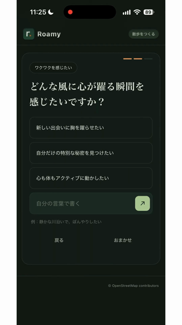
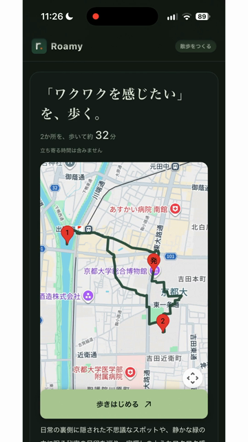
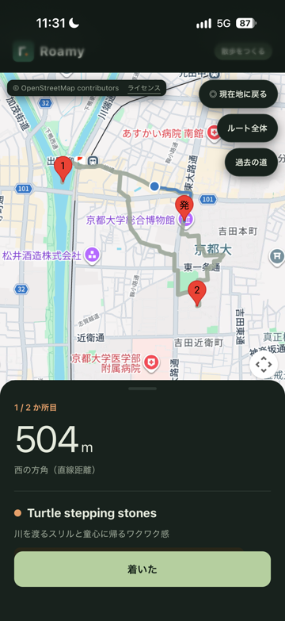

# Roamy（ローミー）— 気分で、知らない近所を歩く

> 知らない場所は、目的地にできない。だから、気分を目的地にする。

気分をひとこと入力すると、AI が1問だけ聞き返し、その気分を感じられる **いま開いている実在の場所** を巡って、出発地に戻ってくる一周の散歩ルートをつくる Web アプリです。
DevFest GDG Japan Hackathon 2026（テーマ：Own the why, Build with Intent／カテゴリ：観光）の提出作品です。

- **デモ**：https://walk-780700843334.asia-northeast1.run.app （2026-11-14 まで公開。対応エリアは京都市中心部）
- **デモ動画**：[動画のURL]
- **チーム Roamy**：@peach-ca（画面）・@w4ter-fox（サーバー・クラウド）

<table>
  <tr>
    <td align="center" width="33%"><br>① 1問だけ聞き返す</td>
    <td align="center" width="33%"><br>② 出発地に戻る一周のルート</td>
    <td align="center" width="33%"><br>③ 着いたかは自分で決める</td>
  </tr>
</table>

## 解決したい課題

人は、名前を知っている場所にしか行けません。だから旅行者は同じ名所に集まり、住んでいる人は近所の場所を知らないままになります。

| 2025年の数字 | 人数 | 出典 |
|---|---|---|
| 日本を訪れた外国人 | 約4,268万人（暫定値） | 日本政府観光局（JNTO）訪日外客数 |
| 新しく来日した留学生 | 約17.6万人（速報値） | 出入国在留管理庁「令和7年の出入国在留管理業務の状況」在留資格「留学」の新規入国者 |
| 国内で別の市区町村に引っ越した人 | 約519万人 | 総務省統計局「住民基本台帳人口移動報告 2025年結果」 |

3つの数字は比べたり足したりするものではなく、「その街の初心者」の例です。初心者が知っている名前は名所だけで、地図アプリは「カフェ」「神社」と打てば答えてくれますが、「泣きたい」「にぎやかに過ごしたい」という気分からは探せません。

Roamy は名前ではなく気分で行き先を決めます。遠くの名所ではなく、まだ知らない近所を歩いて楽しむ、マイクロツーリズムの入口をつくることが目的です。静けさを求めれば静かな場所へ、にぎやかさを求めればにぎやかな場所へ案内します。

## 使い方

1. 気分をひとこと入力する（例：「ワクワクを感じたい」）
2. AI の聞き返しに、選択肢・自分の言葉・「おまかせ」のどれかで答える。人の多さの好みもここで決まる
3. 歩く時間（30 / 45 / 60分）と出発地を選び、ルートを作る。合わない場所は「外す」で除いて作り直せる
4. 歩く。次の場所から50m以内に来ると知らせるが、自動では進まない。着いたかは本人が「着いた」で決める
5. 「求めていた気分は、感じられた？」に、ひとことメモを残す
6. 最後の場所のあとは、出発地への帰り道を案内する。戻ったら「戻った」で終わり
7. 散歩日記と足あとマップで、気分・立ち寄った場所・メモ・歩いた道を見返す

時間は **歩く時間だけ** の目安です（立ち寄った場所で過ごす時間は含みません）。

## 仕組み：気分は AI に、事実は地図に、時間はコードに


1回のルート作成は、次の順で進みます。

| | 担当 | すること |
|---|---|---|
| 1 | コード | 出発地と指定時間から、OpenStreetMap 由来の候補（京都中心部 約1万件）を近く・中くらい・遠くの3つの距離帯に分け、最大150件を Gemini に渡す |
| 2 | Gemini（Vertex AI） | 候補の中から気分に合う場所を **番号で** 選び、その場所で何を感じられそうかを30字以内で書く（歴史や営業時間などの事実は書かせない） |
| 3 | コード | 私有地らしい名前（マンション、アパート、寮など）、日没後の屋外・寺社・史跡、混雑を避けたい人には有名所19か所の200m以内を外す |
| 4 | コード | 直線距離から徒歩時間を見積もり、指定時間に収まる回る場所と順番を決める |
| 5 | Places API | 回る場所だけ、実在・閉業・営業中かを確かめ、学校・病院・ホテルなども外す。外れたら4に戻って組み直す。**結果は Gemini に渡さない** |
| 6 | Routes API | 決めた順番で、実際の徒歩ルートと時間を出す |
| 7 | コード | 行きと帰りの道が2割以上重なれば回り道を足し、時間が1割以上ずれたら見積もりを直して、6で測り直す |

- Gemini が使えないときは、ルールだけで場所を選んでルートを作ります（応答に `fallback: true`）。
- 外部 API の呼び出しには上限があります。Places は1ルート最大8か所、Routes は1ルート最大4回です。

## なぜこの設計にしたか（Own the why）

### AI に任せる範囲を、あえて狭くした

間違えると歩く人が困ることは、AI に任せませんでした。

| 判断 | AI に任せた場合 | 採用した方法 |
|---|---|---|
| 気分に合う場所を選ぶ | あいまいな言葉を読める | **Gemini に任せる**（Gemini が止まったときはルールで代わりに選ぶ） |
| 場所の名前 | 存在しない場所を作る恐れがある | 番号で選ばせるので、候補にない場所は出ない |
| 営業中か | 学習時点の古い知識で答える | Places API で今の状態を確かめる |
| 私有地・夜・混雑 | 指示しても守ったか確かめられない | コードで必ず同じ判定をする（ただし単語の一覧と名簿なので漏れはある） |
| 時間と順番 | 実際の徒歩時間を知らない | Routes API で測り、コードで組み直す |

その結果、Routes API の徒歩時間で測ると、30分の指定で30〜33分、60分の指定で62〜66分、行きと帰りの道の重なりは0〜18%でした（各3回の計測）。

### 場所の選び方は、5つの方式を同じ条件で比べた

2地点 × 4つの気分で試しました（gemini-3.5-flash）。回数が少ないので、傾向として見てください。

| 方式 | 生成時間 | 結果 |
|---|---|---|
| A. Maps グラウンディング | 17〜44秒 | 9回中2回、地図を参照しなかった |
| B. Places の結果を Gemini に渡す | — | 精度は最良。地図の内容を AI に渡す点に規約上の懸念があり不採用 |
| C. AI が検索語を作り Places で探す | 約9秒 | 清水寺本堂のような有名所が混ざった |
| **D. OSM → Gemini → Places で確認（採用）** | **8〜15秒** | 気分に合う場所を、有名かどうかに関わらず安定して拾えた |
| E. OSM ＋ グラウンディング | ＋6〜8秒 | 8回中0回、地図を参照しなかった |

道の計算は、どの方式でも自前の歩道データではなく Routes API を使います（正確で、サーバーが軽いため）。

### Google の技術を選んだ理由

| 技術 | 使い方 | 選んだ理由 |
|---|---|---|
| Cloud Run | 画面（`web/`）と API（`api/`）を1つのサービスで配信 | 1つのコンテナで画面と API をまとめられる。`--max-instances 1` で回数制限をメモリで数え、費用の上限を読みやすくした |
| Vertex AI（Gemini） | 気分の解釈、聞き返し、場所の選択 | サービスアカウントで呼べるので API キーを置かずに済む。チームに支給された Cloud クレジットを使える |
| Places API (New) | 実在・営業中の確認 | 地図データ（OSM）だけでは今営業しているか分からないため |
| Routes API | 徒歩ルートと時間 | 実際の道で時間を測れるので、指定時間どおりのルートを組める |
| Maps JavaScript API | 地図の表示 | ルートと現在地をスマホで見せるため |

## 安全とプライバシー

- **つらい言葉**（「死にたい」など）が入ったら、AI を呼ぶ前にコードで止め、ルートは作らずに厚生労働省「まもろうよ こころ」を案内します。
- **入ってはいけない場所を出さない**：私有地らしい場所、学校・病院など、閉まっている場所、日没後の屋外・寺社・史跡を外します。京都では観光客が私道に入り込むことが問題になっています。
- **人の多さは本人が選ぶ**：聞き返しで混雑を避けたいと答えた人にだけ、有名所の周りを外します。
- **歩きスマホを促さない**：最初に「画面を見るときは立ち止まる」と案内します。到着は自動では進めず、本人が決めます。
- **散歩の記録はサーバーに集めない**：データベースは持ちません（[ADR 0002](docs/adr/0002-walk-records-in-browser.md)）。散歩日記と歩いた道は、利用者のブラウザ（localStorage）にだけ保存します。
  - 「歩いた道と記録をこのブラウザに保存する」は **初期値オン** です。歩き始める前に外せば、日記と歩いた道は保存しません。歩いている途中で記録だけを止める操作はありません。
  - 散歩日記から1件ずつ、またはすべてを消せます。歩いた道も一緒に消えます。
  - 歩いた道は1回最大1,200点、全体で最大20区間・6,000点、7日より古いものはアプリを開いたときに消します。
  - 保存を外しても、途中から再開するための一時状態（出発地・ルート・気分など）は別に保存され、12時間で破棄します。
- **キーと回数の上限**：サーバー用とブラウザ用のキーを分け、使える API と送り元を制限しています。ルート作成は全体で1日30回・1つの IP から1時間6回、聞き返しは1日200回・1時間20回までです。

## 限界と次の一歩

| いまの限界 | 次の一歩 |
|---|---|
| 対応は京都市中心部（半径約5km）だけ | OSM のデータを差し替えて、ほかの街に広げる |
| 画面は日本語だけ | 英語に対応する |
| 行きたくない場所は外せるが、行きたい場所は追加できない（サーバー側は対応済みで、画面が未対応） | 指定した場所をルートに含められるようにする |
| ヒントは AI の推測なので、外れることがある | 場所の説明を用意し、それを根拠に選ばせる |
| 多くの人が使えば、今度は穴場に人が集まるかもしれない | 同意を得た記録で人の流れを見て、集中しないルートにする（データベースを持つのはそのとき） |
| 日没後は屋外と寺社を外すため、候補が減る | — |
| 記録は同じ端末・同じブラウザにだけ残る | — |

## 設計判断の記録

- [ADR 0002](docs/adr/0002-walk-records-in-browser.md)：サーバーの DB を使わず、記録をブラウザに置く

## 開発者向け

### 構成

```
api/        FastAPI（main.py, selector.py=Gemini, places_check.py, route.py, safety.py, osm_data.py, llm.py, fallback.py）
web/        画面（ビルド不要の HTML / CSS / JavaScript、PWA）
scripts/    build_osm_json.py（OSM → api/data/places.json）
docs/       アーキテクチャ図、ADR、画面の画像
tests/      サーバーの試験（pytest）
web/tests/  画面の試験（Node.js）
```

### ローカルで動かす

必要なもの：Python 3.12 以上、[uv](https://docs.astral.sh/uv/)、Vertex AI を使える Google Cloud プロジェクト、サーバー用キー（Places API・Routes API）、ブラウザ用キー（Maps JavaScript API）。

```bash
uv sync --locked
cp .env.example .env                       # 自分のプロジェクトに合わせて編集
cp web/config.example.js web/config.js     # ブラウザ用キーだけを書く
gcloud auth application-default login

# 場所データを作る（OSM の抽出データが必要。生成物はリポジトリに含めていない）
uv run --env-file .env python scripts/build_osm_json.py

uv run --env-file .env uvicorn api.main:app --reload --port 8080
# http://localhost:8080 を開く
```

キーなしで画面だけを試すときは、`python3 -m http.server 8503 --bind 127.0.0.1 --directory web` で起動し、`http://localhost:8503/?mock=1` を開きます（固定の見本データで動き、AI や地図の API は呼びません）。詳しくは [web/README.md](web/README.md)。

本番は Gemini（Vertex AI）だけを使います。`api/llm.py` には、5つの方式を比べた実験のために別の LLM へ切り替える分岐が残っていますが、本番のイメージ（`requirements.txt`）には入れていません。

### 試験

```bash
uv run --locked pytest -q                  # サーバー 45件
node --test web/tests/*.test.mjs           # 画面 19件
```

試験は実際の API・ブラウザの描画・実機の GPS を使いません。

### デプロイ（Cloud Run）

```bash
gcloud run deploy walk --source . --region asia-northeast1 \
  --allow-unauthenticated --max-instances 1 --memory 512Mi \
  --set-env-vars 'GOOGLE_GENAI_USE_VERTEXAI=true,GOOGLE_CLOUD_PROJECT=<project>,GOOGLE_CLOUD_LOCATION=global,GEMINI_MODEL=gemini-3.5-flash,ROUTE_DAILY_LIMIT=30,MAPS_API_KEY=<server-key>'
```

`api/data/places.json` と `web/config.js` は Git に入っていないため、デプロイ前に手元で用意します。

## データとライセンス

- 場所データ：© OpenStreetMap contributors（[ODbL](https://www.openstreetmap.org/copyright)）
- 地図・場所の確認・ルート：Google Maps Platform（Maps JavaScript API / Places API / Routes API）
- 統計：日本政府観光局（JNTO）、出入国在留管理庁、総務省統計局（上の表のとおり）
- localStorage のキー名（`yorimichi:`）は、旧名「よりみち」の名残です。保存済みの記録を引き継ぐため変えていません。
